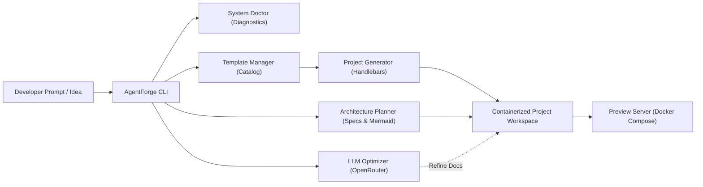

<div align="center">
  
  
  <br />

  <h1>✨ AgentForge v3.0</h1>
  <p><b>Autonomous Full-Stack App Builder & Architecture Engine</b></p>
  <i>Scaffold production-grade, containerized full-stack applications with architectural blueprints at the speed of thought.</i>

  <br />
  <br />

  [](https://www.npmjs.com/package/@shenald/agentforge)
  [](https://typescriptlang.org)
  [](package.json)
  [](https://github.com/shenald-dev)
  [](https://docker.com)
  [](https://openrouter.ai)
  [](LICENSE)
  
  <br />

  <a href="https://frontend-sooty-xi-69.vercel.app"><b>Check out a live generated Next.js App Demo</b></a>
</div>

---

## 📑 Table of Contents
- [🌊 Flow State Initiated](#-flow-state-initiated)
- [✨ What's New in v3.0](#-whats-new-in-v30)
- [🚀 Enterprise Features](#-enterprise-features)
- [🏗️ System Architecture](#️-system-architecture)
- [🛠️ Installation & Setup](#️-installation--setup)
- [💻 Comprehensive CLI Usage](#-comprehensive-cli-usage)
- [🧩 Template Catalog](#-template-catalog)
- [🩺 System Diagnostics (`agentforge doctor`)](#-system-diagnostics-agentforge-doctor)
- [📐 Autonomous Architecture Blueprints](#-autonomous-architecture-blueprints)
- [⌨️ Advanced LLM Integration](#️-advanced-llm-integration)
- [⚠️ Troubleshooting & FAQ](#️-troubleshooting--faq)
- [🤝 Contributing](#-contributing)

---

## 🌊 Flow State Initiated

**AgentForge** is an autonomous full-stack app builder and architectural orchestrator built for Senior Engineers, Founders, and Vibe Coders. Rather than spending days manually wiring Next.js to FastAPI, debugging Docker Compose bridge networking, configuring CORS, and fighting GitHub Actions boilerplate—AgentForge synthesizes and scaffolds your entire stack in seconds.

Simply provide a natural language idea, and AgentForge crafts a complete full-stack codebase—featuring strict TypeScript frontends, scalable REST/WebSocket backends, container orchestration, CI/CD pipelines, and auto-generated system architecture specifications.

---

## ✨ What's New in v3.0

- 📐 **Autonomous Architecture Blueprints (`ARCHITECTURE.md`)**: Automatically writes a production-ready architectural specification for every generated project, complete with Mermaid system topology diagrams, REST/WebSocket API contracts, and security posture checklists.
- ⚡ **Scriptable / Non-Interactive CLI Mode**: Fully automate scaffolding in scripts and CI/CD pipelines using `--name`, `--template`, `--output`, `--skip-install`, `--dry-run`, and `--force`.
- 🩺 **AgentForge Doctor (`agentforge doctor`)**: Built-in environment diagnostic suite that pre-flights Node.js (v18+), Git, Docker Engine daemon health, Docker Compose (v2 plugin vs standalone), OpenRouter keys, and port collisions on `3000`/`8000`.
- ℹ️ **Template Catalog & Deep Inspection (`agentforge list --details` / `agentforge info <template>`)**: Detailed stack components, default ports, and category metadata for every template.
- 🔍 **Safe Dry-Run Simulations (`--dry-run`)**: Preview the full rendered file tree and compiled template sizes without writing to disk.
- 🐳 **Adaptive Docker Orchestration**: Seamlessly detects and leverages either the modern Docker Compose v2 CLI plugin (`docker compose`) or standalone binary (`docker-compose`) with leak-free signal management.
- 🧪 **Expanded Verification Suite**: 54 comprehensive unit and integration tests with 100% pass rate.

---

## 🚀 Enterprise Features

- **⚡ Instant Scaffolding**: Generate production-ready `SaaS`, `Landing+API`, or `Realtime` templates in under 2 seconds.
- **🐳 Zero-Config Container Previews**: The built-in `agentforge preview .` command spins up multi-container Docker environments locally.
- **🧠 Autonomous AI Vibe Pass**: When an `OPENROUTER_API_KEY` is present, AgentForge automatically refines project documentation and system architecture using cutting-edge models.
- **🛡️ Strict Type-Safe Boilerplate**: Ships with `Next.js 14 App Router`, `FastAPI` (Python 3.11), `Pydantic v2`, `Express`, and `Socket.io`.
- **🌐 Vercel-Ready**: Native edge routing injected automatically via `vercel.json`.
- **🔄 Automated CI/CD**: Pre-configured GitHub Actions test and lint pipelines for both frontend and backend tiers.

---

## 🏗️ System Architecture

AgentForge utilizes a modular compilation pipeline:



---

## 🛠️ Installation & Setup

### Prerequisites

Ensure the following tools are installed:
- **Node.js** (v18 or higher)
- **Docker** and **Docker Compose** (Docker Desktop recommended)
- **Git**

Verify your environment anytime by running:
```bash
npx @shenald/agentforge doctor
```

### Install AgentForge

Install globally via npm:
```bash
npm install -g @shenald/agentforge
```

Or execute directly with `npx`:
```bash
npx @shenald/agentforge create "A developer productivity dashboard"
```

---

## 💻 Comprehensive CLI Usage

### 1. Interactive Scaffolding

Launch the visual interactive wizard:
```bash
agentforge create
```
Or pass an initial concept:
```bash
agentforge create "A high-performance crypto analytics dashboard"
```

### 2. Scriptable & Non-Interactive Automation

Bypass all prompts for scripts, CI/CD, or batch generation:
```bash
agentforge create "Subscription billing tracker" \
  --name billing-tracker \
  --template saas \
  --output ./projects/billing \
  --skip-install
```

#### Available `create` Flags:
| Flag | Description |
|:---|:---|
| `-n, --name <name>` | Project name (kebab-case, e.g. `my-saas`) |
| `-t, --template <name>` | Template type (`saas`, `landing-api`, `realtime`) |
| `-o, --output <dir>` | Custom output directory destination |
| `--skip-install` | Skip automatic `npm install` post-generation |
| `--dry-run` | Preview files that would be generated without writing to disk |
| `--no-llm` | Skip LLM README and architecture refinement |
| `--no-plan` | Skip `ARCHITECTURE.md` generation |
| `-f, --force` | Overwrite target directory if it already exists |

### 3. Safe Dry-Run Simulation

Inspect what will be created without modifying the filesystem:
```bash
agentforge create "Real-time canvas" --name canvas-app --template realtime --dry-run
```

### 4. Template Discovery & Inspection

List all available templates:
```bash
agentforge list
```

View detailed tech stack, exposed ports, and descriptions:
```bash
agentforge list --details
```

Inspect a specific template in depth:
```bash
agentforge info saas
```

### 5. Local Docker Compose Preview

Spin up the containerized application locally:
```bash
cd my-app
agentforge preview .
```

### 6. Authentication Setup

Securely store your OpenRouter API key for autonomous AI enhancements:
```bash
agentforge auth
```

---

## 🧩 Template Catalog

| Template | Stack | Default Ports | Ideal Use Case |
|:---|:---|:---:|:---|
| **`saas`** | Next.js 14, FastAPI (Python), Tailwind CSS, Docker | Frontend: `3000`<br/>Backend: `8000` | SaaS products, data analytics, ML APIs |
| **`landing-api`** | Next.js 14, Express (TypeScript), Tailwind CSS, Docker | Frontend: `3000`<br/>Backend: `8000` | Marketing pages, REST microservices, lead gen |
| **`realtime`** | Next.js 14, Socket.io (Node.js), Tailwind CSS, Docker | Frontend: `3000`<br/>WebSocket: `8000` | Chat apps, collaborative tools, live dashboards |

---

## 🩺 System Diagnostics (`agentforge doctor`)

AgentForge includes an automated doctor to diagnose environment health:
```bash
agentforge doctor
```

Output:
```
🩺 AgentForge System Diagnostics Report
  ✔ Node.js Environment: Node.js v20.10.0 (v18+ requirement met) [PASSED]
  ✔ Git CLI: git version 2.43.0 [PASSED]
  ✔ Docker Engine: Docker version 24.0.6 (Daemon active) [PASSED]
  ✔ Docker Compose: Docker Compose version v2.21.0 (Plugin v2) [PASSED]
  ✔ OpenRouter LLM Integration: Configured (sk-or-v1-***42a) [PASSED]
  ✔ Port 3000 (Frontend default port): Available [PASSED]
  ✔ Port 8000 (Backend default port): Available [PASSED]

✨ System is fully configured and ready to forge applications!
```

---

## 📐 Autonomous Architecture Blueprints

Every scaffolded project includes a comprehensive `ARCHITECTURE.md` file featuring:
- **Mermaid Topology Diagrams** illustrating frontend, backend, and database network flow.
- **Service Contracts** detailing REST and WebSocket endpoints.
- **Container Network Specifications** for Docker Compose bridging.
- **Security & Authentication Posture** (CORS, JWT/Session handling, env secret isolation).
- **Production Deployment Checklists** for Vercel, AWS ECS, Google Cloud Run, and Fly.io.

---

## ⌨️ Advanced LLM Integration

AgentForge supports free and paid models via OpenRouter:
- Set via CLI: `agentforge auth`
- Or via environment variable: `export OPENROUTER_API_KEY="sk-or-v1-..."`
- Custom OpenRouter base URL: `export OPENROUTER_BASE_URL="https://openrouter.ai/api/v1"`

When present, AgentForge automatically refines the generated README and system architecture to deeply align with your specific domain.

---

## ⚠️ Troubleshooting & FAQ

### Docker Compose Not Found
If running `agentforge preview` complains about Docker Compose:
- Run `agentforge doctor` to check whether `docker compose` (v2 plugin) or `docker-compose` (standalone) is installed.
- Ensure Docker Desktop is running.

### Port Conflicts
If port 3000 or 8000 is occupied, `agentforge doctor` will flag the conflict before you attempt container initialization.

---

## 🤝 Contributing

Contributions are welcome!
1. Fork the repository.
2. Create your feature branch (`git checkout -b feat/amazing-improvement`).
3. Verify test and lint suites (`npm test && npm run lint`).
4. Commit your changes (`git commit -m 'feat: add custom template support'`).
5. Open a Pull Request.

---

<div align="center">
  <sub>Built with ❤️ by <a href="https://github.com/shenald-dev">shenald-dev</a>. Scaffold at the speed of thought.</sub>
</div>
